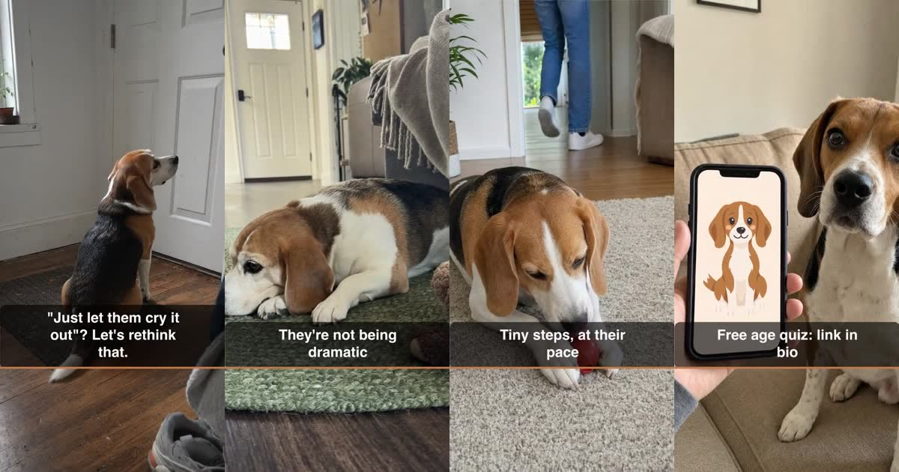
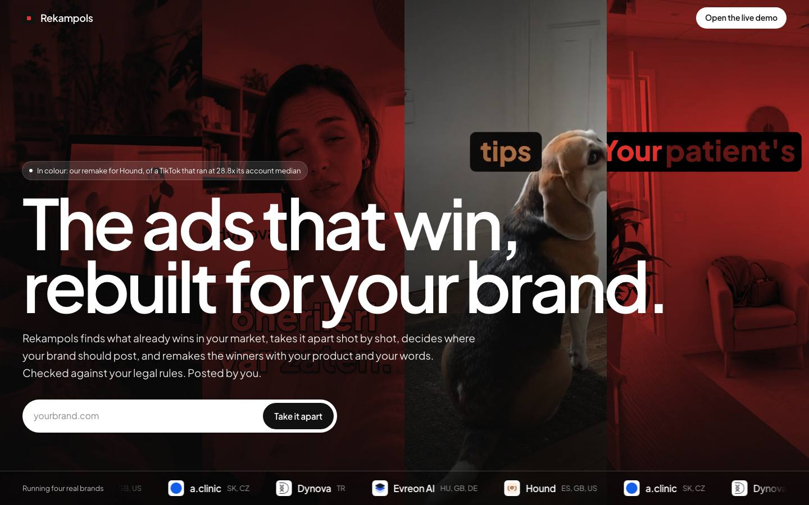
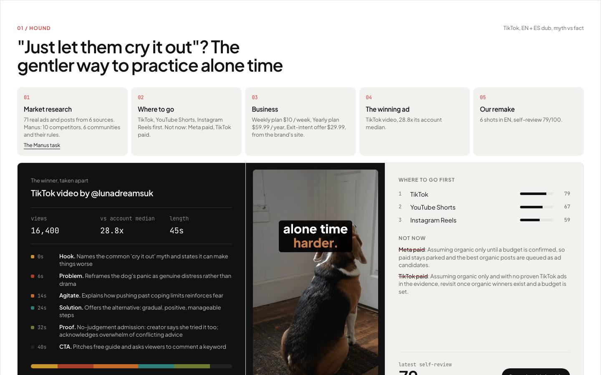
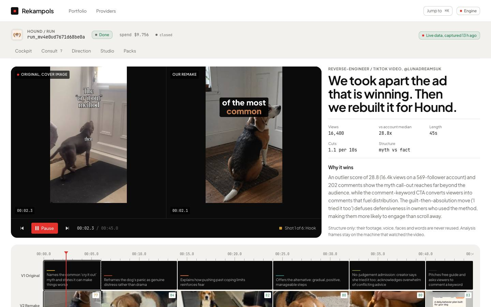
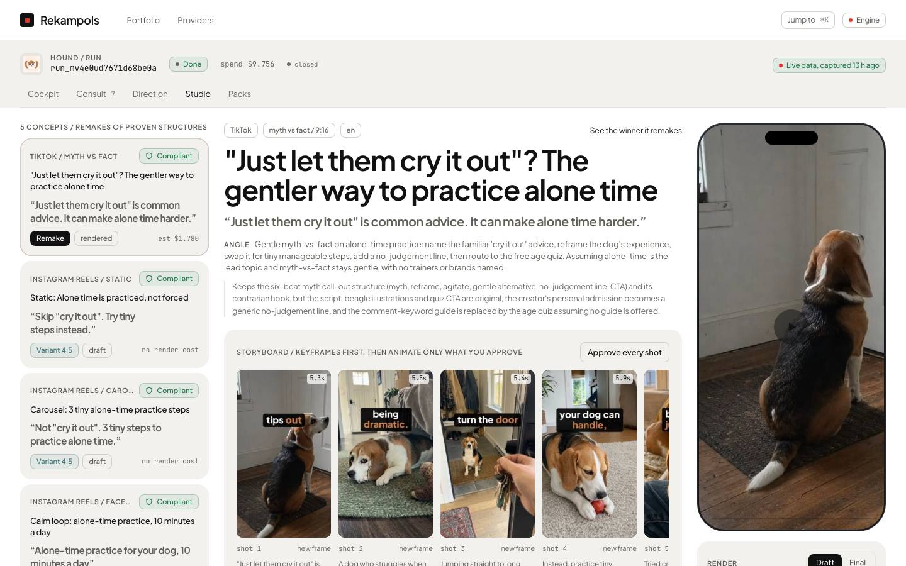

<div align="center">

# Rekampols

**The ads that win, rebuilt for your brand.**

A go-to-market agent for operators who run many brands: it finds the ads and posts that already win in each brand's market, takes them apart shot by shot, decides where the brand should post (and where not yet), and remakes the winners with the brand's own product, voice and language, checked against its legal rules.

[Live demo](https://rekampols.xyz) · [How it works](#how-it-works) · [Run it locally](#run-it-locally) · [Architecture](docs/ARCHITECTURE.md)




</div>

## Why

Founders who run several brands do marketing by hand: scroll the ad library, ask a chatbot which ads work, brief a freelancer, hope. Rekampols does the whole loop as one agent, with evidence at every step and a human in charge of anything that goes out.

## How it works

| Step | What happens |
|---|---|
| **1. Enter** | Paste a site. The brand's dossier (offers, claims, colours, voice) is read from it. |
| **2. Watch the winners** | Competitor ads and organic posts that outperform their account, from TikTok, Instagram, Reddit, YouTube and the Meta Ad Library, plus a deep-research task on the market, its competitors and its communities. |
| **3. Blueprint** | Each winning video taken apart shot by shot: hook, beats, pacing, on-screen text, sound, and why it wins. |
| **4. Consult** | Only the questions the data could not answer. Skip one and the agent states its assumption. |
| **5. Direct** | Every channel scored on six axes: where to go first, and where not to go yet, with the reason. |
| **6. Remake** | The winning structure rebuilt with the brand's own product, images, voice and words. Never the creator's footage, face or script. |
| **7. Check the law** | Every script, caption and frame against the brand's rule pack before anything renders (for example: no prescription drug names for a telehealth brand). |
| **8. Pack** | Video, caption, hashtags, posting time and checklist. A human posts it. |



## Results on four real brands

The showcase runs on four brands its authors operate, with real recorded research:

- **Hound** (dog-training app, ES/GB/US): TikTok first; a remake of a myth-vs-fact TikTok that ran at 28.8x its account median, in English with a Spanish dub.
- **a.clinic** (doctor-led weight care, SK/CZ): a Slovak listicle remake; Meta paid ads refused by the rule pack (prescription telehealth needs LegitScript certification), drug names never appear.
- **Dynova** (personal health data, TR): a Turkish explainer remake.
- **Evreon AI** (clinic software, HU/GB/DE): LinkedIn first, a founder-style demo clip.



| Reverse-engineer view | Studio |
|---|---|
|  |  |

## Where each tool runs

| Tool | What it does in the product |
|---|---|
| Claude (Anthropic) | Every decision: research plan, relevance filter, shot-by-shot blueprints, the consultation, channel scores, scripts, the compliance check, the self-review of every cut. |
| Manus | Deep research per brand (channels, competitors, community self-promotion rules, every fact sourced) and a campaign landing page per pack, through the Manus API v2. |
| Apify | Meta Ad Library, TikTok, Instagram and Reddit scrapers for the winning ads and posts. |
| Spiral | Meta and TikTok ad intelligence: winners with transcripts and creative analysis. |
| Firecrawl | Reads the brand's site into its dossier. |
| fal | Kling image-to-video for the remake shots (Higgsfield's Kling as the fallback). |
| ElevenLabs | The cast voice per brand and language, music beds, sound effects, dubbing. |
| Gemini | Watches whole videos with sound: the winners, and our own cuts before they ship. |
| OpenAI | Keyframes and transcription. |

## Run it locally

Requirements: Node 22+, pnpm 11 (`corepack enable`), macOS or Linux.

```bash
pnpm install
pnpm dev            # http://localhost:3000
```

- With no keys, every provider runs on labelled demo data and the UI says so. Copy `.env.example` to `.env` and add the keys you have. A provider makes real calls only when its key is present **and** it is listed in `LIVE_PROVIDERS`; every paid call goes through a spend ledger with per-provider caps (`BUDGET_USD_*`).
- The recorded runs of the four brands are seeded into a local SQLite file (`data/`) on the first request.
- `NEXT_PUBLIC_DATA_MODE=mock pnpm dev` runs the whole UI on in-browser fixtures, with no engine at all.
- The public site is the same app in read-only mode: see [deploy/README.md](deploy/README.md).

| Command | What it does |
|---|---|
| `pnpm check` | Typecheck, lint (Biome) and unit tests (Vitest). Never calls a live API. |
| `pnpm e2e` | Playwright end-to-end tests on the in-browser mock. |
| `demo/offline-check.sh` | Walks the demo path with every non-local network request refused. |
| `pnpm onboard <url> <name>` | Creates a brand and runs intake and live research up to the consultation. |
| `pnpm full-run <slug>` | A full run on top of a brand's recorded research. |

## Project layout

```
src/app          Next.js routes: the landing, the operator app, and the API (src/app/api)
src/components   The cockpit UI
src/engine       The agent: phases, providers, compliance, video composition, spend ledger
src/contracts    Zod schemas shared by the UI and the engine, plus recorded fixtures
e2e              Playwright tests
docs             Product spec, architecture, design, brand rule packs, renders
```

## How it was built

Two parallel build sessions (an engine lane and a UI lane) worked from a shared spec and synced through git overnight and during the event. The build log is kept as it happened: [CLAUDE.md](CLAUDE.md) (rules for the build sessions), [coord/](coord/) (protocol, tasks, status and messages between the two lanes) and [docs/DECISIONS.md](docs/DECISIONS.md) (every decision with its reason).

## Principles

- **No invented numbers.** Metrics come from the platforms or the operator; until then the UI says "Waiting for first metrics".
- **Remake, never copy.** A winner's structure is reused; its footage, voice, faces and words are not.
- **Compliance gates everything.** Nothing renders or exports before it passes the brand's rule pack.
- **Nothing goes out without a human.** The agent never posts, never spends ad money, never sends messages.
- **Demo data is labelled as demo**, in the data and in the UI.

## Contributing

Issues and pull requests are welcome: see [CONTRIBUTING.md](CONTRIBUTING.md). Please report security problems privately, as described in [SECURITY.md](SECURITY.md).

## License

[MIT](LICENSE) for the code. Third-party fonts, adapted components and brand assets keep their own terms: see [NOTICE.md](NOTICE.md).

Built at 10X Your Brand (Slush'D x Manus), Istanbul, 12 October 2026, by Team Nexus.
